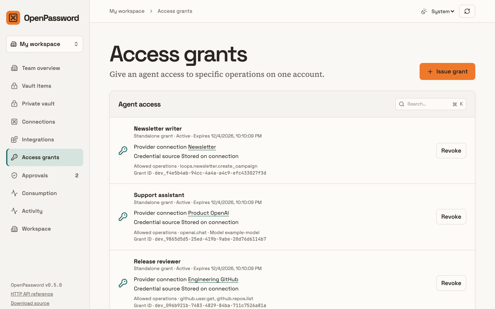
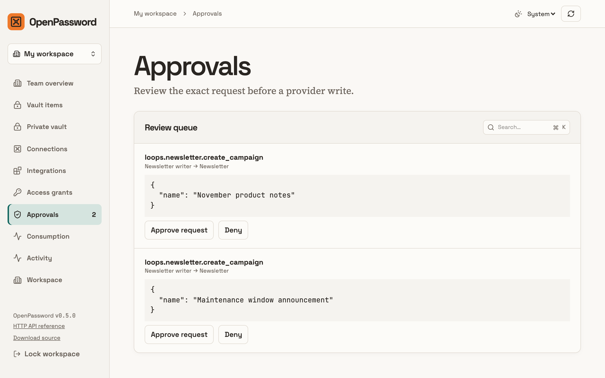
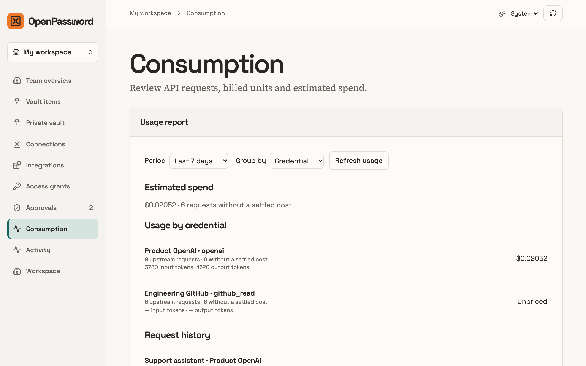
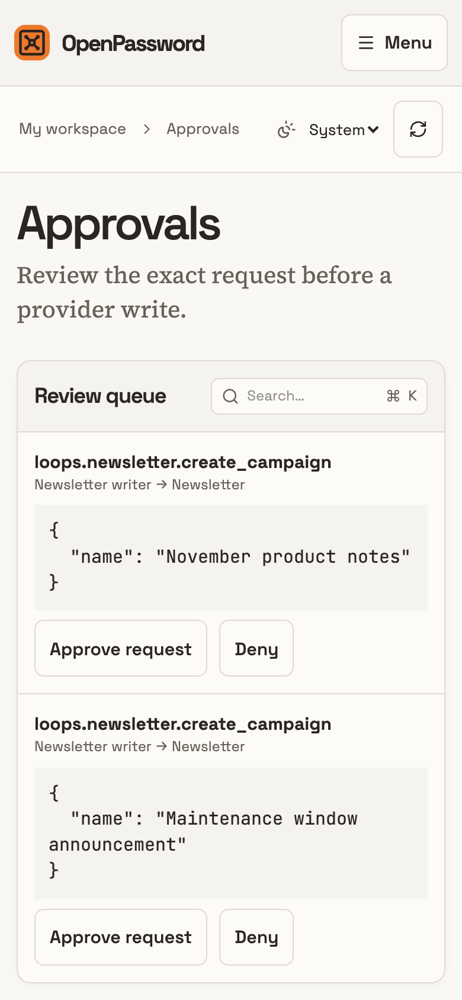
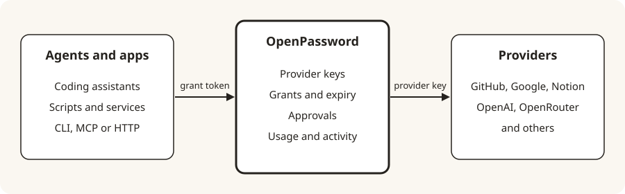

# OpenPassword

**Let your agents use your accounts without handing them your keys.**

OpenPassword is a self-hosted credential manager and model router. Your provider keys stay on your server. Each agent or application gets its own grant: chosen operations, an expiry, a record of what it did, and a switch to turn it off.

<picture>
  <source media="(prefers-color-scheme: dark)" srcset="docs/img/grants-dark.png">
  
</picture>

*One grant per agent: what it may do, and until when.*

<picture>
  <source media="(prefers-color-scheme: dark)" srcset="docs/img/approvals-dark.png">
  
</picture>

*Two drafts waiting for a person, each with the arguments it would send.*

<picture>
  <source media="(prefers-color-scheme: dark)" srcset="docs/img/consumption-dark.png">
  
</picture>

*See what each credential and agent used, with estimated spend.*



<sub>Screenshots are from a throwaway installation with made-up accounts and agents; no provider was contacted (<code>scripts/screenshots.ts</code>). They show standalone grants; on a new installation each grant is also bound to an enrolled host.</sub>

## How it fits



## Quick start

From the root of a cloned or extracted copy of this project, with **Node.js 24 LTS**, **npm**, **Make** and **Go 1.25 or later** installed. `make setup` downloads the two engines' sources from the Go module proxy, so it needs network access (or a module cache that already holds them):

**Run as:** your own account · **Where:** the project root on your computer; leave `make dev` running · **sudo:** no

```sh
make setup
make dev
```

1. Open **http://localhost:3000**. The first visit shows **Set up your team vault**. Choose **On this computer** and **User installation**.
2. As the same account, in the project root, run `node public/openpassword-cli.cjs setup-code` in a second terminal (no sudo). The ten-minute code is for creating the first administrator.
3. Enter the code, select **Continue to account**, choose a username and password, and create your account. First-time setup closes as soon as the administrator exists. Google, GitHub, and Apple sign-in are optional.

The administrator lands on **Team overview**. Choose **Add shared login** to store a team account, add a teammate and check their access record.

To connect an application or agent, add a **connection**, a named provider account whose credential OpenPassword stores. A **grant** gives one client permission to use that connection for selected operations and a limited time. Next: [connect a coding agent](docs/walkthroughs.md#connect-an-agent), which on a new installation starts by enrolling the agent's machine, or [route a model request](docs/walkthroughs.md#route-a-model-request).

## What makes it different

- **The key stays put.** A client holds a grant token for chosen operations on one connection. The provider key is used by the server and is not sent to the client.
- **Narrow and temporary.** Grants name their operations and expire. Revoking one stops later calls.
- **You approve writes.** Operations that need approval wait for a person, with a preview of the request. If you give a grant a standing draft allowance, drafts within it do not wait.
- **Model access with limits.** A model grant is fixed to one connection and one model, with a call limit, a cap on output tokens per request and an optional budget.
- **Bound to a host.** New workspaces require agent requests to be signed by an enrolled host, so a copied token is not enough on another machine.
- **A private vault for people.** Personal items are encrypted in the browser. Handing one to the gateway is an explicit step that creates a separate copy.
- **HTTP, CLI and MCP.** Use it from a script, a coding assistant or an application. Chat Completions is OpenAI-compatible.

**Limits you should know.** Behavior with physical authenticators has not been verified, and there has been no independent cryptographic review. Read [SECURITY.md](SECURITY.md) before relying on it for anything sensitive.

| I want to… | Start here |
| --- | --- |
| Show a company how shared logins work | [Three-minute team demo](docs/company-demo.md) |
| Give Codex or Claude Code an MCP tool | [Connect an agent](docs/walkthroughs.md#connect-an-agent) |
| Make a model request from my app | [Route a model request](docs/walkthroughs.md#route-a-model-request) |
| Call it directly from a service or script | [HTTP quickstart and API reference](docs/http-api.md) |
| Connect a coding assistant, Python framework or Rasa action to a local CLI | [Native harness integrations](examples/harnesses/README.md) |
| Run the server in the cloud and the agent on my laptop | [Deploy on a server](#deploy-on-a-server) |
| Set up passkeys, sharing, recovery or a separate model gateway | [Security operations](docs/security-custody.md) |

## Personal vault and approved agent hosts

For a personal password or API key, open **Private vault**, generate and confirm your saved key, choose a separate vault passphrase, and add the item there. **Delegate to gateway** creates a separate provider connection only when you authorize a copy.

Run `openpassword host connect` as the dedicated host service account on the agent machine, and `openpassword pair` as each agent's own account; the [host instructions](docs/operations.md#enroll-an-agent-host-and-approve-its-agents) say which steps need sudo. For a machine that runs several agents, issue a **host enrollment token** under Workspace, then run `openpassword host connect` on that machine and start its signing bridge. Each agent runs `openpassword pair` through the bridge. Approve each request under Access grants with its own connection, operations and expiry. New workspaces require host approval. Existing standalone workspaces switch when their first host enrolls. Follow the [host installation and agent enrollment instructions](docs/operations.md#enroll-an-agent-host-and-approve-its-agents).

## Deploy on a server

The Linux console and broker listen on loopback. Expose the required public API paths through your own HTTPS reverse proxy. Keep the console accessible through the operator's private route. Serve signed CLI assets to approved client machines. Set OPENPASSWORD_WEB_ORIGIN to the canonical HTTPS origin used in host proofs.

1. **Release operator · gate host · no sudo.** Build and verify one exact commit, its signed CLI and its release digest. Follow the signing and packaging commands in [SECURITY.md](SECURITY.md).
2. **Deployment operator · production server · sudo required.** Install the verified archive with the one-command updater in [operations](docs/operations.md#upgrade-a-running-systemd-installation).
3. **First administrator · own workstation · no local sudo.** Run `openpassword setup-code --ssh user@server` with a verified SSH alias. A system service requires remote permission to read the operator credential. A per-user service supports `--user`. Open the private console, enter the short-lived code and create the account. Human onboarding works before any agent exists.
4. **Host administrator · agent host · service account.** After account creation, generate a host ticket in Workspace and follow the [host enrollment instructions](docs/operations.md#enroll-an-agent-host-and-approve-its-agents). Agents request separate grants.

For a private trial over SSH, on your laptop as your own account (no sudo), forward the console with `ssh -N -L 127.0.0.1:3000:127.0.0.1:3000 user@server` and use the local quickstart URLs while the tunnel is open.

## Share access and track usage

| Control | How it works |
| --- | --- |
| Ownership | Administrators manage organization credentials. Personal credentials start private. Their owners can rotate them and share access with named people or the whole workspace. |
| Expiry | Set a deadline for the credential itself, an individual recipient, or organization-wide sharing. A grant ends at the earliest applicable deadline. |
| Approvals | For a tool call requiring approval, review the operation and arguments in **Approvals**. The client retries with the same request key to obtain the result. |
| Consumption | Inspect upstream requests by credential or agent grant. Revocation stops future access and preserves the request history. |
| Human sign-in | Link Google, GitHub, Apple, or a password under **Workspace → My profile**. Configure installation-wide sign-in providers under **Workspace → Authentication**. |

## Operate and contribute

OpenPassword stores encrypted provider credentials, grants, and usage history in SQLite. The encryption key lives in a separate file on the server. For a restorable offline backup, stop the service and copy the **entire data directory**, including `master.key`, preserving permissions. The default location is `~/.openpassword`; use `OPENPASSWORD_HOME` to choose another.

- [Provider and deployment reference](docs/operations.md) — OAuth callbacks, connector setup, backups, service configuration, and integration workflows.
- [Contributing](CONTRIBUTING.md) — contribution terms and how to verify a change. In the project root, as your own account (no sudo), run `make verify` to build the packages, check types, run tests, and build the console.
- [Changelog](CHANGELOG.md) — project release history.

This candidate distributes the server, console, first-party packages and examples under [AGPL-3.0-only](LICENSE). Package license files retain notices for previously MIT-licensed material. Third-party assets retain their own licenses.

## Update an existing installation

For the supplied Linux services, on the server as root, install the exact gate-built archive using `sudo sh deploy/upgrade.sh --install ARCHIVE SHA256 VERSION COMMIT`. The updater checks readiness. If activation fails before the new release goes public, it restores the previous build; a later failure is recovered forward with `--recover`. On each workstation, as the account that uses the CLI (no sudo), `sh deploy/update-client.sh` updates the installed CLI using its configured broker address. [Upgrade and rollback instructions](docs/operations.md#upgrade-a-running-systemd-installation)
